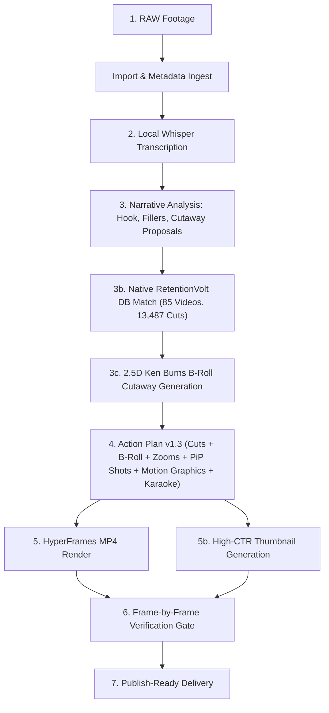

<p align="center">
  <br>
  <h1 align="center">⚡ RETENTION</h1>
  <p align="center">
    <strong>🎥 Edit videos like a pro — 100% Native RetentionVolt Database, 2.5D B-Roll, Animations & Motion Graphics</strong>
  </p>
  <p align="center">
    <a href="#-video-editing-for-the-agent-era"><strong>Features</strong></a> ·
    <a href="#-100-native-retentionvolt-intelligence"><strong>Native RetentionVolt DB</strong></a> ·
    <a href="#-quickstart"><strong>Quickstart</strong></a> ·
    <a href="#%EF%B8%8F-mcp-tools"><strong>MCP Tools</strong></a> ·
    <a href="TERMS.md"><strong>Terms & Conditions</strong></a>
  </p>
  <p align="center">
    
    <a href="https://modelcontextprotocol.io"></a>
    <a href="https://www.npmjs.com/package/hyperframes"></a>
    <a href="https://github.com/SYSTRAN/faster-whisper"></a>
    <a href="LICENSE.md"></a>
  </p>
  <br>
</p>

---

## 🎥 Video Editing for the Agent Era

Inspired by the programmatic, code-first vision of [Remotion](https://github.com/remotion-dev/remotion), **Retention** brings video creation and retention engineering directly into the AI agent age.

Turn raw, unedited creator recordings into a publish-ready video with millisecond-accurate cuts, **2.5D Ken Burns B-roll cutaways**, **dynamic zoom animations**, **PiP demonstrative workspaces**, **content-aware motion graphics**, **karaoke captions**, and **high-CTR thumbnail covers** — completely agentically and 100% locally:

- **Edit agentically**: Hand your RAW footage over to your AI coding agent (Claude Code, Antigravity, Codex, Cursor) and let it cut, animate, add B-roll, caption, and render automatically.
- **100% Native RetentionVolt Intelligence**: Includes the entire RetentionVolt database embedded natively in `data/` — **85 viral reference videos (13,487 shot/cut events)**, **49 analyzed high-CTR thumbnails**, **15 motion graphics patterns (`MG-001`..`MG-015`)**, and **5 multi-shot retention flows**. Zero external cloud dependencies, zero API keys, zero login prompts.
- **Edit deterministically**: Whisper speech analysis and HyperFrames headless browser composition guarantee millisecond-accurate sync. No timeline dragging, no Premiere, no DaVinci.

---

## ⚡ 100% Native RetentionVolt Intelligence

Retention embeds the complete **RetentionVolt** dataset directly inside the repository (`data/`):

- **`data/retentionvolt_videos.json` (85 Viral Videos • 13,487 Cut/Shot Events)**: Frame-accurate breakdowns of top creators (MrBeast, Marques Brownlee, Ali Abdaal, Fireship, Alex Hormozi, Cleo Abram, Veritasium, Johnny Harris, etc.) across `b_roll` (4,789 events), `camera_angle_switch` (4,081), `motion_graphic` (1,733), `punch_zoom` (1,689), `slow_push_in` (1,110), and `talking_head` hooks.
- **`data/retentionvolt_thumbnails.json` (49 High-CTR Thumbnails)**: Complete CTR estimates, facial emotion analysis, color palettes, composition types, and Midjourney/Flux prompt recipes.
- **`data/retentionvolt_motion_graphics.json` (15 Motion Graphics Specs)**: `MG-001` through `MG-015` with trigger rules, durations, GSAP easing curves, and glassmorphic CSS specs.
- **`data/retentionvolt_flows.json` (5 Multi-Shot Retention Flows)**: Proven sequence templates (`hook_0_15s`, `problem_setup`, `interactive_demo`, `sponsor_segue`, `outro_loop`).

Every video edited with Retention **automatically** runs native similarity matching and applies B-roll cutaways, zoom animations, PiP demonstrations, and motion graphics.

---

## 🧠 Architecture & Pipeline



---

## 🚀 Quickstart

### Prerequisites
- **Node.js**: ≥ 20 (Node 22 recommended)
- **FFmpeg**: Available in system `PATH`
- **Python**: 3.9+ (for `faster-whisper`)

### Installation
```bash
# Clone the repository
git clone https://github.com/Andrea13235/Retention.git
cd Retention

# Install dependencies
npm install

# Run one-time Whisper automated setup
node scripts/setup-whisper.js

# Verify environment readiness
npm run setup-check

# Compile TypeScript
npm run build

# Run comprehensive test suite (50/50 tests passing)
npm test
```

### Configure with your AI Agent (MCP Configuration)
Add to your client configuration (`claude_desktop_config.json`, Cursor MCP, Codex, or Antigravity):

```json
{
  "mcpServers": {
    "retention": {
      "command": "node",
      "args": ["/absolute/path/to/retention/dist/server.js"]
    }
  }
}
```

### Install as an AI Skill (`/Retention.editing` & `/Retention`)
From inside your cloned `Retention` directory, run:
```bash
npm run install-skill
```

---

## 🛠️ MCP Tools

| Tool | Phase | Purpose |
|---|---|---|
| `import_raw_media` | Step 1 | Register RAW footage and extract resolution, duration, fps, and audio streams |
| `transcribe_media` | Step 2 | Local Whisper transcription with millisecond word timecodes (~100 languages) |
| `analyze_transcript` | Step 3 | Narrative analysis: hook, sections, filler words, cut candidates, and cut-safe B-roll cutaway proposals |
| `find_similar_video` | Step 3b | Query the 100% native RetentionVolt database (85 viral videos, 13,487 cuts) for the closest reference blueprint |
| `fetch_retentionvolt_blueprint` | Step 3b | Direct query into the native RetentionVolt database by topic, niche, and format |
| `generate_broll_cutaways` | Step 3c | Generate 2.5D Ken Burns B-roll cutaway visuals with camera drift vectors |
| `generate_edit_plan` | Step 4 | Generate Action Plan v1.3 with cuts, B-roll cutaways, zoom animations, PiP shots, motion graphics, and karaoke captions |
| `generate_thumbnail` | Step 4b | Extract hook base frame and export high-CTR companion metadata (title, badge, style) |
| `render_video` | Step 5 | Build HyperFrames composition and render final MP4 (`draft`/`standard`/`high` presets) |
| `verify_render` | Step 6 | Mandatory Frame-by-Frame Quality Gate: extract screenshots across key beats & audit sync/safety |

---

## 📦 Repository Layout

```
Retention/
├── SKILL.md                              # Agent workflow: native RetentionVolt pipeline
├── data/
│   ├── retentionvolt_videos.json         # 85 analyzed viral videos (13,487 shot/cut events)
│   ├── retentionvolt_thumbnails.json     # 49 analyzed high-CTR thumbnails
│   ├── retentionvolt_motion_graphics.json# 15 motion graphics patterns (MG-001..MG-015)
│   └── retentionvolt_flows.json          # 5 multi-shot retention flows
├── docs/
│   └── analysis-guide.md                 # Editor craft: cut rules, attention curve, EditPlan reference
├── src/
│   ├── server.ts                         # MCP server (stdio transport)
│   ├── retentionvolt_client.ts           # 100% Native RetentionVolt database engine
│   ├── tools_ingest.ts                   # Step 1: RAW import + ffprobe metadata
│   ├── tools_transcribe.ts               # Step 2: local Whisper, word timecodes, language detect
│   ├── tools_analyze.ts                  # Step 3: hook, sections, fillers, cut-safe cutaway proposals
│   ├── tools_image.ts                    # Step 3c: 2.5D Ken Burns B-roll image & SVG visual synthesis
│   ├── tools_plan.ts                     # Step 4: Action Plan v1.3 (always-on RetentionVolt, B-roll, animations, graphics)
│   ├── tools_render.ts                   # Step 5+6: HyperFrames render, thumbnail generator & frame verifier
│   └── types.ts                          # TypeScript contracts & schemas
└── tests/                                # 50/50 passing tests (unit, pipeline, native DB, e2e)
```

---

<p align="center">
  Crafted by <a href="https://github.com/Andrea13235"><strong>Andrea Barretta</strong></a>
</p>
